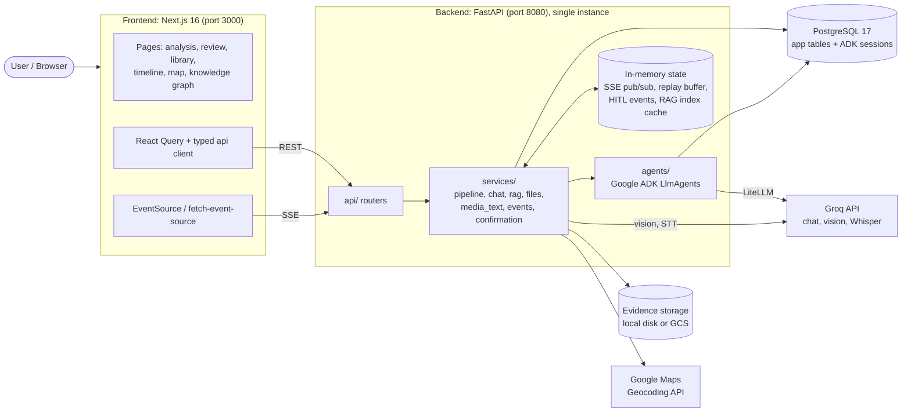
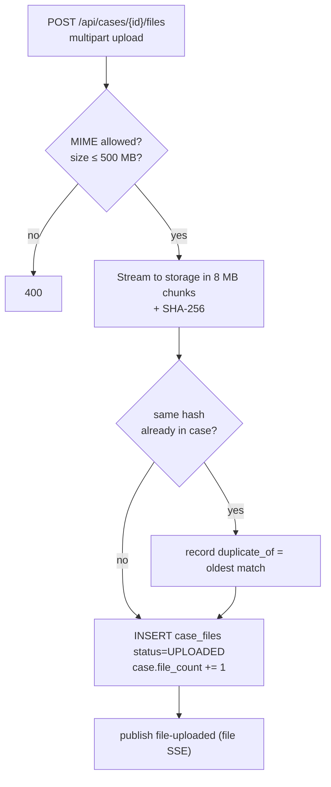
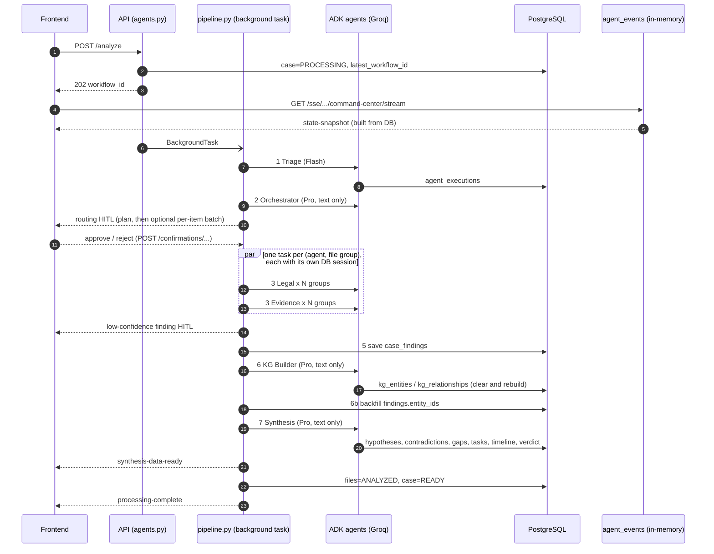
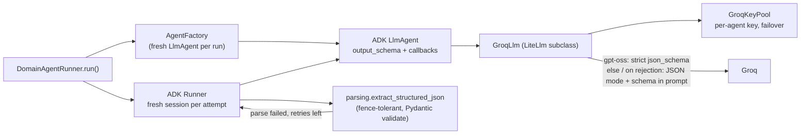
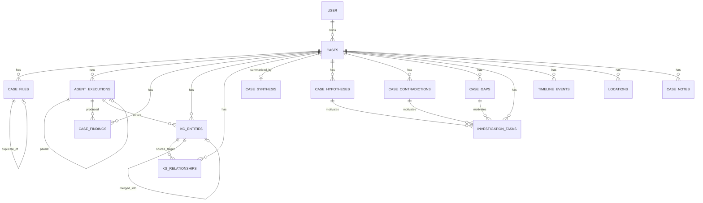

# Legal Lens: Architecture

Legal Lens is a legal-evidence intelligence platform. A user creates a **case**, uploads evidence (PDF, image, audio, video), and a multi-agent pipeline turns that evidence into findings, a knowledge graph, a timeline, contradictions / gaps / hypotheses, a verdict, an on-demand geospatial map, and a cited chat. Every claim carries a citation (`file_id` + `locator` + verbatim `excerpt`) that opens the source file at the exact page or timestamp.

This document describes the system **as the code in this checkout actually behaves**. Where `.planning/` or `DOCS/` disagree with the code, the code wins, and the differences are listed in [section 15](#15-docs-vs-code-differences). It was written by reading the whole repo; file references are relative to this folder.

> Contents: [1 System overview](#1-system-overview) · [2 Repository layout](#2-repository-layout) · [3 Tech stack](#3-tech-stack) · [4 Runtime topologies](#4-runtime-topologies) · [5 Backend structure](#5-backend-structure) · [6 Evidence ingestion](#6-evidence-ingestion) · [7 Analysis pipeline](#7-analysis-pipeline) · [8 Agent system](#8-agent-system) · [9 Real-time layer](#9-real-time-layer-sse--hitl) · [10 Secondary paths](#10-secondary-paths-rag-chat-geospatial) · [11 Data model](#11-data-model) · [12 API surface](#12-api-surface) · [13 Frontend](#13-frontend) · [14 Deployment](#14-deployment-and-tooling) · [15 Docs vs code](#15-docs-vs-code-differences) · [16 Limitations](#16-known-limitations-and-risks) · [17 Extending](#17-extension-recipes)

---

## 1. System overview



Core ideas:

1. **Evidence becomes text first.** Groq chat models are text-only, so [`media_text.py`](backend/app/services/media_text.py) converts every file to text (with page markers and timestamps) before any agent sees it.
2. **Stages are isolated.** Every pipeline stage runs in a *fresh ADK session*. Data moves between stages through the database, never through session state.
3. **Everything is cited.** Agent prompts require `file_id`, `locator`, and a verbatim `excerpt`. The RAG path additionally *verifies* every quote against the page text and drops unverifiable ones.
4. **Humans stay in the loop.** Low-confidence routing and findings pause the pipeline until the user confirms in the UI (HITL).
5. **Real-time by SSE.** The pipeline emits lifecycle events; the UI renders them live and can rebuild its state from a DB snapshot after a refresh.

---

## 2. Repository layout

Bun workspaces (frontend + `packages/*`) plus a uv-managed Python backend.

```
legal lens/
├── backend/                  FastAPI + Google ADK service
│   ├── app/
│   │   ├── main.py           app wiring, middleware, router registration
│   │   ├── config.py         pydantic-settings (all configuration)
│   │   ├── database.py       async SQLAlchemy engine / sessionmaker
│   │   ├── api/              HTTP routers (15 modules)
│   │   ├── services/         business logic (pipeline, chat, RAG, files, events, HITL, ...)
│   │   ├── agents/           ADK agents, runners, prompts/, factory, Groq adapter
│   │   ├── models/           SQLAlchemy 2 ORM models
│   │   ├── schemas/          Pydantic request/response + agent output schemas
│   │   ├── groq_keys.py      multi-key pool with per-agent affinity and failover
│   │   ├── llm_schema.py     Pydantic -> strict JSON schema for Groq
│   │   ├── local_storage.py  local-disk evidence storage
│   │   └── storage.py        GCS client helpers
│   ├── alembic/versions/     11 hand-written migrations
│   ├── storage/              local evidence + RAG cache (runtime artifact)
│   └── Dockerfile            python:3.12-slim + uv
├── frontend/                 Next.js 16 App Router, React 19, Tailwind 4
│   └── src/{app,components,hooks,lib,types,contexts}
├── packages/types/           OpenAPI-generated TypeScript types (src/generated/api.ts)
├── terraform/                GCP: Cloud Run, Cloud SQL, GCS, Artifact Registry, Secret Manager, IAM
├── DOCS/                     original design docs (partly stale), UI guides, architecture PNG
├── .planning/                phase plans / summaries / state (GSD workflow, partly stale)
├── backend/redaction_modal/  two empty placeholder files (img.py, video.py)
├── docker-compose.yml        Postgres 17 (+ Adminer on :8081)
├── Makefile, lefthook.yml    dev commands and git hooks
└── CLAUDE.md                 contributor guidance
```

Sample evidence for demos lives in `samples/` (court-judgment PDFs) and `backend/sample.pdf`.

---

## 3. Tech stack

| Layer | Technology |
|---|---|
| Frontend | Next.js 16.1 (App Router, standalone output), React 19.2 + React Compiler lint rules, Tailwind 4, TanStack Query 5, D3 (force/zoom/drag/scale/selection), `@xyflow/react`, `@vis.gl/react-google-maps`, `@react-pdf-viewer/*` with **pdfjs-dist 3.x pinned**, wavesurfer.js, framer-motion, react-markdown, zod, react-hook-form, sonner |
| Backend | Python ≥ 3.12, FastAPI, SQLAlchemy 2 async + asyncpg, Alembic, Pydantic v2 / pydantic-settings, `sse-starlette`, PyJWT |
| Agents | Google ADK (`google-adk`) with `LlmAgent` + `Runner`; models served by **Groq through ADK's LiteLLM wrapper** (`litellm` pinned `<1.80.17`) |
| Evidence-to-text | PyMuPDF (PDF text + page rendering), Groq vision model (OCR and image description), Groq Whisper (audio), `pydub`/`ffmpeg` (video audio track), Pillow (resize, EXIF) |
| Retrieval | In-process BM25 over page chunks (no vector DB) |
| Database | PostgreSQL 17 (JSONB, tsvector GIN indexes, `gen_random_uuid()`) |
| Storage | Local disk (`backend/storage/`) or Google Cloud Storage |
| Geo | `googlemaps` Geocoding API (backend), Google Maps JS (frontend) |
| Infra | Terraform (GCP), Docker (multi-stage), Cloud Run |
| Tooling | uv, bun, ruff (88 cols, double quotes, E/F/I/B/UP), mypy, eslint 9, prettier, lefthook |

**Default models** ([config.py](backend/app/config.py)); each can be overridden by environment variable:

| Setting | Default | Used by |
|---|---|---|
| `FLASH_MODEL` | `groq/openai/gpt-oss-20b` | triage, chat, Flash fallback |
| `PRO_MODEL` | `groq/openai/gpt-oss-120b` | orchestrator, domain agents, KG builder, synthesis, geospatial |
| `RAG_MODEL` | `groq/openai/gpt-oss-20b` | fast RAG path |
| `VISION_MODEL` | `qwen/qwen3.8-27b` (raw Groq ID) | scanned-page OCR, image description |
| `STT_MODEL` | `whisper-large-v3-turbo` (raw Groq ID) | audio/video transcription |

"Flash" and "Pro" are deliberately *different models* because Groq's free tier meters tokens per model, so splitting agents across two models roughly doubles throughput.

---

## 4. Runtime topologies

| Concern | Local (this checkout) | Cloud (Terraform) |
|---|---|---|
| Auth | **Disabled.** `DEBUG=true` + `AUTH_DISABLED=true` makes every request act as a fixed dev user. Frontend sends no token. | Better Auth JWTs (JWKS fetched from `FRONTEND_URL/api/auth/jwks`); Better Auth + Google OAuth are expected to run in the frontend service |
| Evidence storage | Local disk, `backend/storage/`, served via `/api/local-files/*` | GCS bucket (`GCS_BUCKET`), V4 signed download URLs |
| ADK artifacts | `InMemoryArtifactService` | `GcsArtifactService` |
| Database | `docker compose` Postgres 17 (compose publishes `5432`; `backend/.env` points at `5433`: make them agree) | Cloud SQL Postgres 17, `db-g1-small`, public IP, Unix-socket connection |
| LLM | Groq API (`GROQ_API_KEY`, optional `GROQ_API_KEYS`) | Same; key from Secret Manager |
| Geocoding | `GOOGLE_MAPS_API_KEY` (read via `os.getenv`, not `Settings`) | Secret Manager |

Local ports: frontend `:3000`, backend `:8080` (Swagger at `/docs`), Postgres `:5432`, Adminer `:8081`.

---

## 5. Backend structure

### 5.1 Layering

```
api/  (routers, auth, ownership checks)
  └─> services/  (pipeline, chat, rag, files, findings, events, confirmation, media_text, geocoding)
        └─> agents/  (factory, runners, prompts, Groq adapter, parsing)
              └─> models/ + schemas/  (SQLAlchemy ORM, Pydantic)
```

[`main.py`](backend/app/main.py) is the wiring point:

- **Lifespan:** configures logging, refuses to start without `DATABASE_URL`, and warms the PDF worker process pool in the background.
- **Exception handlers:** all errors are normalised to `ErrorResponse {code, message, details, recoverable, suggested_action}` (422 validation, HTTP errors, unhandled 500; internals only revealed when `DEBUG`).
- **Middleware:** CORS (origins from `CORS_ORIGINS` plus `FRONTEND_URL`) and a request logger that skips `/health` and `/sse/`. **GZip middleware must never be added: it breaks SSE.**
- **Routers:** `health`, `sse`, `auth`, `cases`, `files`, `local_files`, `agents`, `confirmations`, `knowledge_graph`, `findings`, `synthesis`, `timeline`, `locations`, `chat`, `rag`.

### 5.2 Configuration

All settings live in `Settings` ([config.py](backend/app/config.py)). It loads `backend/.env`, then a root `.env`; real environment variables always win. Notable groups:

- **Groq / models:** `groq_api_key`, `groq_api_keys` (comma/newline list), `flash_model`, `pro_model`, `rag_model`, `vision_model`, `stt_model`, `thinking_level` (reasoning effort for gpt-oss: minimal→low, low, medium, high).
- **Token budgeting (Groq free tier rejects requests over ~8k tokens):** `agent_text_budget_chars` (6000 per agent request; `0` = unlimited), `rag_max_context_chars` (14 000), `max_chars_per_file` (150 000).
- **Evidence conversion:** `pdf_min_text_chars_per_page` (80, below this a page is treated as scanned), `ocr_max_pages_per_file` (10), `pdf_workers` (4), `pdf_parallel_min_pages` (40), `ocr_concurrency` (4), `stt_max_bytes` (25 MB).
- **HITL thresholds:** `confidence_threshold` (40, findings), `routing_hitl_threshold_{legal 50, evidence 20, strategy 40}`, `confirmation_timeout_seconds` (3600).
- **Pipeline timeouts:** defined (`pipeline_timeout_*`) but **not enforced** (no `asyncio.wait_for` is wired).
- **Infra:** `gcs_bucket`, `local_storage_path`, `backend_url`, `frontend_url`, `sse_heartbeat_interval_seconds` (15), `debug`, `auth_disabled`, `dev_api_key`.

### 5.3 Authentication and authorization

[`api/auth.py`](backend/app/api/auth.py) provides the `CurrentUser` dependency. Resolution order:

1. `X-Dev-API-Key` header (only when `DEBUG` and `DEV_API_KEY` are set).
2. `Authorization: Bearer <jwt>` validated against the Better Auth JWKS (EdDSA / ES256 / RS256, audience and issuer = `FRONTEND_URL`), then the user is loaded from the Better Auth `user` table.
3. `DEBUG` + `AUTH_DISABLED` → auto-created dev user (`dev-user-0000…`).

**Ownership rule:** every case-scoped route must filter `Case.user_id == current_user.id AND deleted_at IS NULL` (helpers: `get_user_case` / `get_user_file` in [api/files.py](backend/app/api/files.py), plus per-module copies). The `models/auth.py` tables belong to Better Auth and are read-only from Python.

### 5.4 Database access

[`database.py`](backend/app/database.py) holds a lazily created async engine (`pool_size=5`, `max_overflow=10`, `pool_pre_ping`, 30-minute recycle) and an `async_sessionmaker(expire_on_commit=False)`. Routes receive a session through `get_db`. **Background tasks and parallel agents open their own sessions with `_get_sessionmaker()`; an `AsyncSession` is never shared across concurrent tasks.**

ADK itself persists its own sessions in the same Postgres (`DatabaseSessionService`, created from `DATABASE_URL`).

### 5.5 Evidence storage

[`file_service.py`](backend/app/services/file_service.py) streams uploads in 8 MB chunks (limit 500 MB), computes a SHA-256 for duplicate detection, and writes to GCS or, when `GCS_BUCKET` is unset, to local disk via [`local_storage.py`](backend/app/local_storage.py) (path-traversal-safe, mirrors the GCS object layout `cases/{case_id}/files/{file_id}.ext`). Download URLs are signed GCS URLs in the cloud and `/api/local-files/...` URLs locally. The upload whitelist is **PDF, JPEG, PNG, GIF, WebP, MP4, MOV, WebM, MP3, WAV, M4A**; despite the endpoint docstring, DOCX/XLSX/PPTX are *not* accepted.

---

## 6. Evidence ingestion



At analysis time, `file_to_text()` in [`media_text.py`](backend/app/services/media_text.py) converts each file (LRU-cached by `(storage_path, size)`, 64 entries, truncated at `max_chars_per_file`):

| Type | Method |
|---|---|
| PDF | PyMuPDF text per page, with page markers. Files ≥ 40 pages are split across a `ProcessPoolExecutor` (4 workers, warmed at startup). Pages with < 80 extracted chars are treated as scanned: rendered (110 dpi) and OCR'd by the Groq vision model (≤ 10 pages/file, 4 concurrent). |
| Image | Resized (≤ 2048 px / 3 MB), described and transcribed by the vision model, plus an EXIF summary. |
| Audio | Groq Whisper with timestamps (skipped above 25 MB). |
| Video | `ffmpeg` extracts the audio track to MP3, then Whisper. **Only audio is transcribed**; visuals are ignored. |
| Text-like | Decoded as UTF-8. |
| Other | Placeholder string; conversion errors become a placeholder rather than failing the run. |

`build_agent_content()` ([adk_service.py](backend/app/services/adk_service.py)) then labels each file (`--- File: name (ID: uuid) ---`) and shrinks the set to `agent_text_budget_chars` (short files stay whole; the rest is shared among longer ones, each keeping ≥ ~500 chars and a note that the text is an excerpt).

---

## 7. Analysis pipeline

Entry point: `POST /api/cases/{id}/analyze` ([api/agents.py](backend/app/api/agents.py)).

- Returns **409** if the case is already `PROCESSING`.
- Modes: `uploaded_only` (default; processes `UPLOADED` files and retries `ERROR` ones) and `rerun_all` (resets `ANALYZED`/`ERROR` files to `UPLOADED` first).
- Sets case → `PROCESSING`, stores a new `latest_workflow_id`, and schedules `run_analysis_workflow` as a FastAPI `BackgroundTask`. Returns **202** with `workflow_id`.



### Stage reference

| # | Stage | Model | Input | Output / side effects | Failure handling |
|---|---|---|---|---|---|
| 1 | **Triage** ([triage.py](backend/app/agents/triage.py)) | Flash | file texts | `TriageOutput`: per-file domain scores, summaries, complexity, entities, suggested groupings | Fatal: files → `ERROR`, pipeline returns |
| 2 | **Orchestrator** ([orchestrator.py](backend/app/agents/orchestrator.py)) | Pro | text summary of triage only | `OrchestratorOutput`: routing decisions (target agents, confidence, context injection), file groups, research trigger | If it yields nothing, pipeline continues with no domain agents (files stay `PROCESSING`) |
| 3a | **Routing HITL** | n/a | routing decisions | Pairs below the per-agent confidence threshold are flagged; one plan-level confirmation, then optionally a single batch dialog for per-item review. Rejected agents are removed from decisions and groups | n/a |
| 3b | **Domain agents** ([domain_runner.py](backend/app/agents/domain_runner.py)) | Pro, Flash fallback | file texts + group context | `LegalOutput` / `EvidenceOutput`: findings (with citations), entities | Per-task errors are swallowed into `output=None` → `agent-error` SSE; one failure never cancels siblings |
| 4 | **Finding HITL** | n/a | findings with `confidence < 40` | User approve/reject. **Rejection is logged only; rejected findings are still saved.** | n/a |
| 5 | **Save findings** ([findings_service.py](backend/app/services/findings_service.py)) | n/a | domain outputs | rows in `case_findings` (citation quality validated), `finding-committed` events | n/a |
| 6 | **KG Builder** ([agents/kg_builder.py](backend/app/agents/kg_builder.py)) | Pro | all findings (`[FINDING:uuid]` prefixed) + domain entity JSON + case description | Clear-and-rebuild `kg_entities` / `kg_relationships`, with savepoints per row so one bad row cannot poison the session; computes entity degrees | Non-blocking: rollback + `agent-error`, pipeline continues |
| 6b | **Entity backfill** | n/a | entities by `source_execution_id` | `case_findings.entity_ids` | n/a |
| 7 | **Synthesis** ([agents/synthesis.py](backend/app/agents/synthesis.py)) | Pro | case metadata, files, findings, KG entities and relationships | Clear-and-rebuild `case_synthesis`, `case_hypotheses`, `case_contradictions`, `case_gaps`, `investigation_tasks`, `timeline_events`, plus `cases.verdict_label/summary`; emits `synthesis-data-ready` after commit | Non-blocking |
| 8 | **Finalize** | n/a | n/a | files → `ANALYZED`; aggregate tokens/entities/duration; `processing-complete`; case → `READY`; replay buffer cleared | Outer `except` marks files and case `ERROR`; a `finally` safety net forces any still-`PROCESSING` case to `ERROR` |

Not in the pipeline:

- **Strategy agent.** Implemented ([strategy.py](backend/app/agents/strategy.py), [prompts/strategy.py](backend/app/agents/prompts/strategy.py), `StrategyOutput`) but `pipeline.py` never invokes it. The orchestrator schema still lets it pick `"strategy"` as a target, but `_DOMAIN_AGENT_TYPES = {"legal", "evidence"}` filters it out.
- **Financial agent.** Appears in the original design diagram; there is no financial agent in the code (only vestigial mentions in prompts/schemas).
- **Geospatial** is on-demand, not a stage (see [10.3](#103-geospatial)).

### Transaction and session discipline

The coordinator holds one long-lived session for triage → orchestrator → persistence stages and commits after each stage so other sessions (SSE snapshot, domain agents) can see the new `agent_executions` rows. Domain agents each use a session from the factory and commit their own execution record. Error recovery, the final `READY` update, and the safety net use *fresh* short-lived sessions so a poisoned main session cannot block status updates.

---

## 8. Agent system

### 8.1 Roster

| Agent | Where | Model role | Output schema | Persisted to |
|---|---|---|---|---|
| Triage | `agents/triage.py` | Flash | `TriageOutput` | `agent_executions` |
| Orchestrator | `agents/orchestrator.py` | Pro | `OrchestratorOutput` | `agent_executions` |
| Legal | `agents/legal.py` (`LEGAL_CONFIG`) | Pro → Flash | `LegalOutput` | `agent_executions`, `case_findings` |
| Evidence | `agents/evidence.py` (`EVIDENCE_CONFIG`) | Pro → Flash | `EvidenceOutput` (adds quality assessment: ADMIT / VERIFY / CHALLENGE / EXCLUDE, corroboration) | same |
| Strategy (unused) | `agents/strategy.py` | Pro → Flash | `StrategyOutput` | n/a |
| KG Builder | `agents/kg_builder.py` | Pro → Flash | `KgBuilderOutput` | `kg_entities`, `kg_relationships` |
| Synthesis | `agents/synthesis.py` | Pro → Flash | `SynthesisOutput` | six synthesis tables + case verdict |
| Geospatial | `agents/geospatial.py` | Pro → Flash¹ | `GeospatialOutput` | `locations` |
| Chat | `services/chat_service.py` | Flash | free text (no schema) | ADK session history |

¹ `AgentFactory.create_geospatial_agent` defaults to Flash, but `DomainAgentRunner.run()` always tries `MODEL_PRO` first, so geospatial effectively runs Pro with Flash fallback.

Prompts live in `agents/prompts/*.py` and share a section layout plus [`_citation_rules.py`](backend/app/agents/prompts/_citation_rules.py). Citations must carry `file_id`, `locator` (e.g. `p.3` or a timestamp), and a verbatim `excerpt`.

### 8.2 Construction and execution



- **[`AgentFactory`](backend/app/agents/factory.py)** builds a **new `LlmAgent` for every run** (ADK forbids re-parenting an agent). Names go through `_safe_name` → `{type}_{8 chars of case id}`; recover the type with `rsplit("_", 1)`.
- **[`DomainAgentRunner`](backend/app/agents/domain_agent_runner.py)** is a template method used by legal, evidence, strategy, KG builder, synthesis and geospatial: create `AgentExecution` (PENDING → RUNNING) → build content → try Pro with `max_parse_retries` (default 1 retry, fresh session each) → fall back to Flash if Pro produced nothing (skipped when both models are identical) → store output, token counts, thinking traces → COMPLETED / FAILED. On exception it *flushes* the FAILED record (audit trail) and returns `(None, execution_id)`. Standard agents are pure config (`DomainAgentConfig`); text-only agents subclass it and override `_prepare_content`.
- **[`adk_service.py`](backend/app/services/adk_service.py):** singleton `DatabaseSessionService` and artifact service; `create_stage_runner`; deterministic session IDs `sha256(case:workflow:stage)`; `get_or_create_stage_session` (idempotent).
- **[`groq_llm.py`](backend/app/agents/groq_llm.py):** registered with ADK's `LLMRegistry` for `groq/.*`. For gpt-oss models it requests Groq's strict `json_schema` mode (schemas are made strict by [`llm_schema.py`](backend/app/llm_schema.py): all properties required, `additionalProperties=false`); on any other model, or if Groq rejects the schema, it falls back to JSON mode with the schema appended to the prompt. Rate limits (429) are parsed for the "try again in …" hint; the call switches to another key if one is free, otherwise sleeps (up to 8 waits). "Request too large" is never retried.
- **[`groq_keys.py`](backend/app/groq_keys.py):** each agent type maps to a stable key (`index in _AGENT_ORDER % key count`), so concurrent legal/evidence agents land on different keys. Cooldowns are tracked per **(key, model)** because Groq meters models separately. Groq limits are per *organization*, so keys from one account do not add capacity.
- **Structured output rules:** keep schemas simple (`str/int/float/bool/list`; no `dict[str, str]`, no arbitrary-key dicts). Lists of `{key, value}` entries (`MetadataEntry`) stand in for dicts.
- **ADK callbacks** ([base.py](backend/app/agents/base.py)) only feed `thinking-update` and `tool-called` SSE events. Lifecycle events (`agent-started/complete/error`) come from the `emit_*` helpers in the pipeline, because callback payloads lack `taskId`/`fileId`; `AGENT_SPAWNED/COMPLETED` are intentionally unmapped.

### 8.3 Parallelism

[`compute_agent_tasks`](backend/app/agents/domain_runner.py) is the single source of truth for what runs. It creates one task per `(agent_type, file_group)` from the orchestrator's `file_groups`, then adds per-file tasks for `(file, agent)` pairs not already covered by a group. Group labels (`grp_0`, `ungrouped_2`) become the **compound agent id** (`legal_grp_0`) used in SSE events, ADK session names, and the state snapshot. All tasks run under `asyncio.gather(return_exceptions=True)`, each with its own DB session. The same function pre-computes the `agent-started` events so the UI matches reality.

---

## 9. Real-time layer (SSE + HITL)

### 9.1 Event bus

[`services/agent_events.py`](backend/app/services/agent_events.py) is an **in-process** pub/sub keyed by `case_id`, with a 50-event replay buffer per case. Every payload carries an explicit `type` that the frontend dispatches on.

| Event | Emitted when |
|---|---|
| `state-snapshot` | on SSE connect, built from `agent_executions` for `Case.latest_workflow_id` |
| `agent-started` / `agent-complete` / `agent-error` | per agent instance (compound ids for domain agents) |
| `thinking-update`, `tool-called` | from ADK callbacks during model calls |
| `thinking-update` with `isFallback: true` | a domain agent fell back from Pro to Flash (no separate event type; the UI shows it as a warning badge) |
| `confirmation-required/resolved`, `confirmation-batch-required/resolved` | HITL |
| `finding-committed`, `kg-entity-added`, `kg-relationship-added` | persistence milestones |
| `synthesis-data-ready` | after synthesis commit (frontend can now safely fetch) |
| `geospatial-complete` | geospatial background task done |
| `processing-complete` | pipeline finished (file/entity/token/duration totals) |

### 9.2 Endpoints ([api/sse.py](backend/app/api/sse.py))

- `GET /sse/cases/{id}/command-center/stream`: snapshot, then live events (replayed for agents absent from the snapshot), 15 s heartbeat.
- `GET /sse/cases/{id}/files`: file-uploaded / file-status / file-deleted / file-error.
- `GET /sse/heartbeat`: skeleton.
- Chat uses a separate **POST** SSE stream (see [10.2](#102-chat)).

### 9.3 Reconnect strategy

On refresh the UI starts from idle skeletons, receives a DB-built snapshot (authoritative: agents missing from it revert to idle), and merges in replayed buffered events. The frontend also mirrors agent state in `sessionStorage` to bridge agents whose execution row is not yet committed.

### 9.4 Human-in-the-loop

[`services/confirmation.py`](backend/app/services/confirmation.py) blocks the pipeline coroutine on an `asyncio.Event` per request (single and batch variants), with a 1-hour timeout (`confirmation_timeout_seconds`). The UI resolves them via `POST /api/cases/{id}/confirmations/{request_id}` and `.../confirmations/batch/{batch_id}`; `GET .../confirmations/pending` supports reconnection. Pending requests, results and the replay buffer are all in process memory.

---

## 10. Secondary paths (RAG, chat, geospatial)

### 10.1 Fast RAG path

A deliberately lightweight alternative to the full pipeline ([rag_service.py](backend/app/services/rag_service.py), [api/rag.py](backend/app/api/rag.py), frontend `/analysis` page):

1. Read every PDF in the case concurrently and extract per-page text (shared with `media_text`).
2. Chunk pages (1000 chars, 150 overlap) and index in memory (BM25, k1=1.5, b=0.75, English stopword list). Cached per case by file-set signature; scanned-only PDFs are rejected.
3. `analyze`: retrieve top chunks per facet (5 per facet, ≤ 30 total, ≤ 14k chars), make **one** JSON-mode/strict-schema Groq call → `Analysis` (facts, events, issues, parties).
4. `ask`: retrieve top 8 chunks and answer with citations.
5. **Every quote is verified against the page text** (`_verify`, `_verify_tree`); citations that fail are dropped.
6. Analysis results are cached at `storage/cases/{id}/rag_analysis.json`.

### 10.2 Chat

`POST /api/cases/{id}/chat` ([api/chat.py](backend/app/api/chat.py), [chat_service.py](backend/app/services/chat_service.py)): requires completed analysis (400 otherwise). A Flash `LlmAgent` with no output schema gets a system prompt built from case metadata, the latest synthesis, and row counts, plus four case-bound tools ([chat_tools.py](backend/app/agents/chat_tools.py)): `query_knowledge_graph`, `get_findings`, `get_synthesis`, `search_findings` (Postgres full-text). History persists in an ADK session keyed `sha256(case:user:chat)`. The stream emits `chat-token`, `chat-tool-start`, `chat-tool-end`, `chat-done` (with extracted citations), `chat-error`. Citations in text use `[[file_id|locator|label]]`.

### 10.3 Geospatial

On-demand, not part of the pipeline. `POST /geospatial/generate` (202; `force=true` to regenerate) schedules a background task that assembles text from case, synthesis, timeline, entities and findings; runs the geospatial agent; **geocodes** any location without coordinates through Google Maps (`geocodable_address`, falling back to name; in-memory cache); then clear-and-rebuilds `locations`. Progress is tracked in an in-memory `_generating_cases` set; the UI polls `GET /geospatial/status` (≈3 s). Needs `GOOGLE_MAPS_API_KEY`, otherwise generation fails with "Google Maps API key required". Paths are counted but not stored.

---

## 11. Data model



| Table | Purpose / notable columns |
|---|---|
| `user` (+ `session`, `account`, `verification`, `jwks`) | Better Auth tables, **read-only** from Python |
| `cases` | `status` DRAFT/PROCESSING/READY/ERROR, `type` FRAUD/CORPORATE/CIVIL/CRIMINAL/OTHER, `file_count`, `latest_workflow_id`, `verdict_label` (Conclusive/Substantial/Inconclusive), `verdict_summary`, soft-delete `deleted_at` |
| `case_files` | storage path, MIME, size, category (DOCUMENT/IMAGE/VIDEO/AUDIO), `status` UPLOADING→UPLOADED→QUEUED→PROCESSING→ANALYZED/ERROR, `content_hash`, `duplicate_of`, optional lat/lng, description |
| `agent_executions` | one row per agent invocation: agent name, model, status, JSONB input/output, token counts, thinking traces, `parent_execution_id` (audit chain: triage → orchestrator → domain agents), workflow id |
| `case_findings` | agent type, group label, category, title, `finding_text`, confidence, JSONB `citations`, JSONB `entity_ids`, tsvector index for full-text search |
| `kg_entities` | name, normalized name, type (8+1 taxonomy), brief/detailed description, aliases, domains, `source_finding_ids`, degree, `merged_into_id`; JSONB `properties` |
| `kg_relationships` | source/target entity, type, label, strength, `evidence_excerpt`, `source_finding_ids`, temporal context, `corroboration_count` |
| `case_synthesis` | case summary, JSONB verdict, key findings, cross-domain conclusions, risk assessment |
| `case_hypotheses`, `case_contradictions`, `case_gaps` | synthesis outputs with JSONB evidence/citations and status/severity |
| `investigation_tasks` | follow-up tasks with FKs to the hypothesis/contradiction/gap that motivated them |
| `timeline_events` | dated events with layer, citations, entity links |
| `locations` | name, JSONB `coordinates`, `location_type`, JSONB `citations`, `source_entity_ids`, `temporal_associations` |
| `case_notes` | model + schemas exist; **no router yet** |

Conventions: UUID primary keys (`gen_random_uuid()`), `ON DELETE CASCADE` from `cases`, JSONB for flexible agent output. Never name a SQLAlchemy attribute `metadata` (use `properties`; the API field `metadata` maps to it).

**Migrations** ([backend/alembic/versions](backend/alembic/versions)) are hand-written, linear except for one merge:

```
d8ed3accb0f4 cases → 461979103c5a case_files → a7c2f9e83d12 duplicate_of → 0562cc9e65bd agent_executions
→ b3a1f7c42e90 latest_workflow_id → c7a1f8d23e51 knowledge tables → e4b2c1a37f90 KG schema for LLM builder
→ ┬ add_case_notes_001
  └ f8a3b2c91d40 investigation_tasks + verdict cols
→ 475d688d81ea (merge) → daad8c23f758 citations on locations   (head)
```

---

## 12. API surface

All case-scoped routes enforce ownership. Types are exposed through FastAPI OpenAPI → `packages/types`.

| Area | Endpoints |
|---|---|
| Health | `GET /health`, `/health/db`, `/health/storage` |
| Auth | `GET /api/auth/me` |
| Cases | `POST/GET /api/cases`; `GET/PATCH/DELETE /api/cases/{id}` (soft delete) |
| Files | `POST/GET /api/cases/{id}/files`; `GET .../files/{fid}/download`; `PATCH .../{fid}/dismiss-duplicate`; `DELETE .../{fid}`; `POST .../bulk-delete`; `GET /api/local-files/{path}` (local storage) |
| Analysis | `POST /api/cases/{id}/analyze`; `GET /api/cases/{id}/analysis/{workflow_id}`; `GET /api/agents/executions/{execution_id}` |
| HITL | `POST /api/cases/{id}/confirmations/{request_id}`; `GET .../confirmations/pending`; `POST .../confirmations/batch/{batch_id}` |
| Findings | `GET /api/cases/{id}/findings`, `/findings/search`, `/findings/{fid}` |
| Knowledge graph | `GET .../graph`; `GET/POST .../entities`; `PATCH/DELETE .../entities/{eid}`; `GET/POST .../relationships` |
| Synthesis | `GET .../synthesis`, `/hypotheses`, `/hypotheses/{id}`, `/contradictions`, `/gaps`, `/tasks` |
| Timeline | `GET .../timeline`, `/timeline/{event_id}` |
| Geospatial | `POST .../geospatial/generate`; `GET .../geospatial/status`, `/locations`, `/locations/{id}`, `/paths`; `DELETE .../geospatial` |
| Chat | `POST .../chat` (SSE) |
| RAG | `GET .../rag/analysis`; `POST .../rag/analyze`, `/rag/ask` |
| SSE | `GET /sse/cases/{id}/command-center/stream`, `/sse/cases/{id}/files`, `/sse/heartbeat` |

Route-ordering rule: declare literal routes (e.g. `/findings/search`) **before** `/{id}` routes.

---

## 13. Frontend

### 13.1 Structure

```
src/app/
├── (marketing)/page.tsx          dark landing page
├── (app)/layout.tsx              shell: Sidebar, DetailSidebar, Toaster, theme
├── (app)/cases/page.tsx          case list
└── (app)/cases/[id]/
    ├── layout.tsx                case header, polling, AnalysisTrigger, global Chatbot
    ├── page.tsx                  redirects to /analysis
    ├── analysis/                 fast RAG analysis + Q&A
    ├── review/                   pipeline progress + HITL modals + verdict
    ├── library/                  evidence upload / management
    ├── timeline/                 synthesis timeline
    ├── geospatial/               map
    └── knowledge-graph/          D3 graph
```

The case layout fetches the case, polls every 10 s while `PROCESSING`, shows the verdict/status badge, hosts `AnalysisTrigger`, and mounts the `Chatbot` on every case page.

### 13.2 Data flow

- **REST:** React Query plus the typed wrapper in [`api-client.ts`](frontend/src/lib/api-client.ts) (`NEXT_PUBLIC_API_URL`, default `http://localhost:8080`). Per-feature clients in `lib/api/*`; hooks in `hooks/`. Put filters in the `queryKey`.
- **Auth:** [`auth-client.ts`](frontend/src/lib/auth-client.ts) `getToken()` always returns `null`; [`middleware.ts`](frontend/src/middleware.ts) only redirects `/login` → `/cases`. No Better Auth routes exist under `src/app/api`.
- **Pipeline SSE:** `useCommandCenterSSE` (native `EventSource`, exponential-backoff reconnect up to 5 attempts) → `useAgentStates` (state machine keyed by compound agent id; handles snapshots, started/complete/error, thinking, HITL queues, `synthesisReady`) → Review page. Events are validated by hand in `lib/command-center-validation.ts` (dispatch on `data.type`); zod is used for forms and timeline types.
- **Chat SSE:** `useChatbot` with `@microsoft/fetch-event-source` (POST, so headers/body are possible).
- **Cross-component signals:** `lib/case-events.ts` (case data changed, analysis reset) as DOM-style events.

### 13.3 Key subsystems

| Subsystem | Implementation |
|---|---|
| Pipeline view | `components/review/PipelineProgress`, `CommandCenter/ConfirmationModal` + `BatchConfirmationModal`, `lib/command-center-config.ts` (agent types: triage, orchestrator, legal, evidence, knowledge-graph, synthesis). The old Command Center page is gone; Review replaced it. Backend agent key `kg_builder` maps to the frontend `knowledge-graph` alias. |
| Verdict | `components/verdict/*` (hypotheses, contradictions, gaps, tasks, key findings, detail panels) fed by `useSynthesisData` |
| Knowledge graph | **D3 force simulation driven by refs**: no React re-render per tick; keep it that way. `useGraphSimulation`, `useGraphSelection`, `useGraphFilters` (disabled-set pattern), rendered by `GraphSvg` inside `KnowledgeGraphCanvas` with `FilterPanel` and entity detail in the app-wide `DetailSidebar` |
| Timeline | `components/Timeline/*`, `useTimelineData`/`useTimelineFilters` |
| Map | `GeospatialMap` via `@vis.gl/react-google-maps`, `useGeospatialData` (polling) |
| Source viewing | `SourceViewerModal` → `PdfViewer` / `AudioViewer` / `VideoViewer` / `ImageViewer`; navigation via `useSourceNavigation`, `CitationLink`, `EntityBadge`, `lib/citation-utils.ts`, `useEntityResolver` |
| Detail sidebar | `DetailSidebarProvider` context; pages push content descriptors (`useDetailSidebarDispatch`) |
| Theming | Dark default; light mode is a warm sepia scoped under `.theme-scope`. Use CSS variables (`var(--card)`, `var(--foreground)`, ...) through `style={{}}`; the landing page stays dark ([frontend/GUIDE.md](frontend/GUIDE.md), [DOCS/UI/DESIGN-SYSTEM.md](DOCS/UI/DESIGN-SYSTEM.md)) |

### 13.4 Frontend rules enforced by lint

React Compiler + `react-hooks` rules: no `setState` in effects or `useMemo`, no ref mutation during render, no module-level regex with `lastIndex`, escape quotes in JSX text. Prefer derived `useMemo`. Legacy/mock code that can be ignored: `components/app/knowledge-graph.tsx`, `lib/mock-*.ts`, `lib/cache/*`.

---

## 14. Deployment and tooling

### 14.1 Terraform (`terraform/`)

| File | Resources |
|---|---|
| `main.tf` | providers (google ~> 6, random), API enablement; **local state** (hackathon mode) |
| `cloud-run.tf` | `legal-lens-backend` (port 8080, 2 vCPU / 1 GiB, 0–10 instances, 300 s timeout) and `legal-lens-frontend` (port 3000, 1 vCPU / 512 MiB, 0–10 instances); both publicly invokable (`allUsers`) |
| `cloud-sql.tf` | Postgres 17, `db-g1-small`, zonal, 10 GB SSD, public IP, **no backups**, random 32-char password |
| `gcs.tf` | `{project}-evidence` bucket (CORS `*`, 30-day delete lifecycle) and public-read `{project}-media` bucket |
| `secrets.tf` | Secret Manager: Groq key, Google Maps key, Better Auth secret, Google OAuth client id/secret |
| `iam.tf` | per-service service accounts, Cloud SQL client, bucket access, self-sign for signed URLs, Workload Identity Federation for CI |
| `artifact-registry.tf` | container registry |

CI/CD (GitHub Actions + WIF) is described in the plans but **the workflow file is not in this checkout**. See `.planning/LESSONS-LEARNED.md` for WIF/Docker/Turbopack gotchas.

### 14.2 Containers

- Backend: `python:3.12-slim`, `uv sync --frozen --no-dev`, `uvicorn app.main:app --host 0.0.0.0 --port 8080`. **The image does not run migrations**, and `ffmpeg` is not installed, so video/audio transcription would not work in the container as written.
- Frontend: three-stage build (bun deps → bun build → `node:20-slim` runner) using Next standalone output; `NEXT_PUBLIC_*` values are baked in at build time; `turbopack.root: ".."` is required for the monorepo build.

### 14.3 Developer workflow

```bash
bun install && (cd backend && uv sync --dev)          # install
docker compose up -d postgres                          # database (:5432)
cd backend && uv run alembic upgrade head              # migrate
cd backend && uv run uvicorn app.main:app --reload --port 8080
bun --cwd frontend dev                                 # :3000
make generate-types                                    # regenerate packages/types after any schema/route change
```

lefthook: pre-commit runs ruff format/check, eslint, prettier; pre-push re-runs ruff and fails if `generate-types` leaves a diff in `packages/types/`. Code style: backend files start with two `# ABOUTME:` comment lines; ruff 88 cols, Python ≥ 3.12 (PEP 695 generics are used). There are no tests and no CI config in this checkout.

---

## 15. Docs vs code differences

| Docs / design say | Code actually does |
|---|---|
| Gemini 3 Pro/Flash, native multimodal files | **Groq** via LiteLLM; evidence is converted to text first ([§6](#6-evidence-ingestion)). `GOOGLE_API_KEY` is legacy |
| Default Flash model `groq/llama-3.3-70b-versatile` (CLAUDE.md) | Default is `groq/openai/gpt-oss-20b` ([config.py](backend/app/config.py)); `.env` may override |
| Groq adapter swaps strict schema for JSON mode (CLAUDE.md) | Strict `json_schema` is used on gpt-oss models, with JSON mode as the fallback |
| Better Auth + JWT/JWKS | Backend still validates JWTs, but locally auth is bypassed and the frontend has no auth routes |
| GCS evidence storage | Local disk unless `GCS_BUCKET` is set |
| Command Center page | Removed; Review page hosts progress, HITL and verdict |
| Financial, Legal, Strategy, Evidence domain agents | Only **Legal** and **Evidence** run; Strategy exists but is not invoked; Financial is gone |
| Redaction agent with SAM 2 (architecture PNG, step 10) | Not implemented; `backend/redaction_modal/*.py` are empty |
| Geospatial as pipeline "Stage 9" (`.planning`) | On-demand only |
| `services/kg_builder.py` is dead code (CLAUDE.md) | The programmatic builder is superseded, but `agents/kg_builder.py` still imports `compute_entity_degrees` and `normalize_entity_name` from it, so it is **not** removable as a whole |
| Upload accepts DOCX/XLSX/PPTX (endpoint docstring) | Whitelist is PDF + image/video/audio types only |
| Hypotheses fed to domain agents | Always passed as `[]` |
| `.planning/STATE.md`, `REQUEST_FLOW.md` | Describe the pre-rework Command Center flow and Strategy stage; use this file and the code instead |

`DOCS/Legal-Lens-Arch.png` shows the original target design (Gemini, Financial agent, Redaction/SAM 2). Treat it as the vision, not the current state.

---

## 16. Known limitations and risks

Verified in the code, ordered roughly by impact:

1. **Single-instance only.** SSE subscribers, replay buffers, pending HITL confirmations, geospatial in-flight set, and the RAG index cache are in process memory. A restart loses pending confirmations and in-flight work, and a second instance would split state. Yet `cloud-run.tf` sets `max_instance_count = 10`: pin it to `1` (and consider `--workers 1`) before relying on the cloud deployment.
2. **SSE endpoints are unauthenticated.** `/sse/cases/{id}/command-center/stream` and `/sse/cases/{id}/files` take no `CurrentUser` and do no ownership check (browser `EventSource` cannot send an `Authorization` header). Anyone who knows a case UUID can stream its agent events. `GET /rag/analysis` also returns cached results without an ownership check.
3. **Pipeline survives only while the process does.** Analysis runs as a `BackgroundTask`; there is no durable queue or resume. The `finally` safety net handles in-process failures only. On Cloud Run, CPU may be throttled after the HTTP response unless CPU-always-allocated is configured.
4. **Timeouts not enforced.** `pipeline_timeout_*` settings exist; `asyncio.wait_for` is never applied, so a hung model call can stall a stage (the rate-limit path waits up to ~8 × 70 s).
5. **Shared session for early stages.** Triage and orchestrator (and persistence stages) share one long-lived DB session; only error handling and domain agents use fresh sessions.
6. **HITL rejection is advisory.** Rejected findings are logged but still saved and fed to the KG/synthesis.
7. **Text budget truncation.** With the default `agent_text_budget_chars=6000`, documents are sent to agents as excerpts, which limits finding recall on large evidence. Videos contribute audio only.
8. **Token/rate-limit coupling.** Throughput depends on Groq's per-organization limits; extra keys from one account do not help.
9. **Clear-and-rebuild stages** (KG, synthesis, geospatial) delete previous results before writing; a mid-write failure leaves a partial set until the next run.
10. **Live events vs snapshot** are built by different code paths (`build_agent_result` is used only by the snapshot), so they can drift.
11. **Missing frontend/backend pieces:** timeline SSE hook calls `/timeline/events/stream`, which does not exist; timeline write endpoints and case-notes endpoints are not built; Phases 11 (corrections/regeneration) and 12 (demo prep) have not started; PDF viewer rendering bugs and an untested audio viewer are known.
12. **Operational.** The backend Dockerfile lacks `ffmpeg` and a migration step; Postgres port in `docker-compose.yml` (5432) differs from `backend/.env` (5433); `backend/.env` contains real secrets and must never be printed or committed (the project is not under git here).

---

## 17. Extension recipes

**Add a domain agent**
1. Output schema in `schemas/agent.py` (simple types only) and a prompt in `agents/prompts/<name>.py` using the shared citation rules.
2. `AgentFactory.create_<name>_agent` in `agents/factory.py`.
3. `agents/<name>.py` with a `DomainAgentConfig` and a `run_<name>` function that delegates to `DomainAgentRunner`.
4. Register in `RUN_FNS` and `_DOMAIN_AGENT_TYPES` in `agents/domain_runner.py`; allow it in the orchestrator's `target_agents` literal and prompt; add a threshold in `get_routing_hitl_threshold` if it needs HITL.
5. Add the type to `_AGENT_ORDER` in `groq_keys.py` (so it gets a stable key) and to the frontend `AGENT_CONFIGS` / `extractBaseAgentType`.

**Add a text-only agent stage** (like KG builder or synthesis): subclass `DomainAgentRunner`, override `get_agent_name`, `_get_output_type`, `_create_agent_instance`, and `_prepare_content` (read assembled text from `kwargs`), write results with a clear-and-rebuild + per-row savepoints, and call it from `pipeline.py` inside its own `try/except` with `agent-started/complete/error` events.

**Add an API route:** put it in the right `api/` module, depend on `CurrentUser`, reuse `get_user_case`, declare literal paths before `/{id}`, add Pydantic response models, then run `make generate-types` and commit the `packages/types` diff.

**Add a table:** model in `models/` (export from `models/__init__.py`), hand-written Alembic migration with the correct `down_revision`, and avoid the attribute name `metadata`.

**Add a new SSE event:** add the member to `AgentEventType`, an `emit_*` helper in `agent_events.py`, the literal in `useCommandCenterSSE`, a type in `types/command-center.ts`, validation in `lib/command-center-validation.ts`, and a handler in `useAgentStates`.

**Move to a multi-instance deployment:** replace the in-memory pieces with shared infrastructure: SSE pub/sub and replay buffer → Redis (or Postgres LISTEN/NOTIFY); HITL events → a DB table with polling or pub/sub; analysis → a durable queue/worker; RAG cache → object storage (already file-backed for results).
